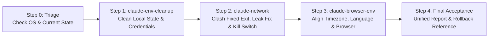

# Claude ENV Setup

<p align="center">
  
</p>

**English** | [简体中文](README.md)

An open-source AI Agent Skill suite for **Windows and macOS** that walks you step-by-step through preparing a clean, consistent, verifiable environment for Claude (Web, Desktop, and Claude Code) — whether you are **recovering from an account ban and resetting your machine** or **setting up Claude cleanly from scratch**.

> **Design Philosophy**: The AI agent only runs read-only audits, explains options, generates plans/scripts, and verifies results. All destructive writes and admin/`sudo` actions are executed by you in a real terminal with explicit confirmation. Every stage creates a full backup with one-click rollback and ends with a consolidated acceptance report.

---

## What Problems Does This Solve?

Users running Claude from restricted or complex network environments often run into repeated verifications, blocks, or connection errors caused by overlapping issues:

1. **Local State & Account Leftovers**: Stale credentials, Keychain/Credential Manager entries, old `userID`/`machineID` (and auto-restored backups), and leftover API relay keys in config files or shell profiles.
2. **Unstable Exits & Network Leaks**: Shared proxy nodes rotating IPs or routing through unsupported regions (Mainland China / HK / Macau), DNS leaks to local resolvers, IPv6 bypassing the tunnel, traffic falling back to your local ISP IP when the proxy drops, or CLI tools (`claude`, `curl`, `git`) using a different exit than your browser.
3. **OS & Browser Mismatches**: Exit IP in the US/Singapore while your OS timezone is still UTC+8, WebRTC leaking your real IP, or logging in with a browser profile carrying cookies from previously banned accounts.

**Claude ENV Setup** organizes the fix into three modular sub-skills orchestrated by the root [`SKILL.en.md`](SKILL.en.md) / [`SKILL.md`](SKILL.md).

---

## End-to-End Workflow



| Order | Module | Responsibility | Safety & Rollback |
|---|---|---|---|
| **Master** | [`SKILL.en.md`](SKILL.en.md) ([中文](SKILL.md)) | Orchestrates Steps 1 → 2 → 3 in strict order, prevents footguns, outputs final acceptance report | Enforces gate checks between stages |
| **Step 1** | [`claude-env-cleanup/`](claude-env-cleanup/) | Audits and cleans Claude Code / Desktop credentials, Keychain/Credential Manager, relay settings, sessions/projects/memory, and rotates `userID`/`machineID` (Basic & Deep modes) | Never permanently deletes; moves items into `~/ClaudeCleanup/<timestamp>/` with `--rollback` |
| **Step 2** | [`claude-network/`](claude-network/) | Configures **Clash Verge Rev 2.x** for "CN direct, everything else through one fixed overseas exit, fail-closed on drop"; supports fixed VPS (Plan A) or static residential SOCKS5 chain (Plan B), DNS/IPv6 hardening, kill switch, and 11-item verification | Full backup to `~/clash-guard-backup/` + desktop emergency sheet + auto-rollback on failure + one-click `restore` |
| **Step 3** | [`claude-browser-env/`](claude-browser-env/) | Audits default browser, per-profile languages, WebRTC status, Claude traces, and antidetect browsers; aligns OS timezone, region, and language to the Step 2 exit city; provides checklists for local or antidetect browsers | Saves original OS values to `~/ClaudeBrowserEnv/<timestamp>/manifest.json` with `--rollback` |

---

## Requirements

- **OS**: Windows 10/11 or macOS
- **Python**: 3.9+ (standard library only — zero third-party `pip` dependencies)
- **Proxy Client** (required for Step 2): [Clash Verge Rev](https://github.com/clash-verge-rev/clash-verge-rev) 2.x with an active subscription imported

---

## Quick Start

### 1. Clone the Repository

```bash
git clone https://github.com/Yetu2000/claude-env-setup.git
```

### 2. Add to Your AI Agent

Place this repository (or the master `SKILL.en.md` / `SKILL.md` together with `claude-env-cleanup/`, `claude-network/`, and `claude-browser-env/`) into your AI agent's skills directory (e.g., Codex, Antigravity, Cursor, OpenCode).

> **Important Notes**:
> - If you use **Claude Code** itself, do **not** store this repo exclusively inside `~/.claude/skills/` before running Step 1 with `--mode deep` (deep cleanup moves `~/.claude/skills/` into the backup folder).
> - A running Claude Code session cannot clean itself — Step 1 write operations must be run in a regular terminal.

### 3. Prompt Your Agent

Tell your AI agent:

> Follow `claude-env-setup` (`SKILL.en.md`) and walk me step-by-step through setting up my Claude environment: clean local state first, then configure the network and fixed overseas exit, then align timezone/language and browser settings, and finish with a full acceptance report.

Each sub-skill can also be used standalone — see the individual READMEs inside each folder.

---

## What Does the Final Acceptance Check Cover?

At the end of Step 3, the agent compiles a **Final Acceptance Report** strictly from live script outputs:

1. **Local Cleanup Verification**: Re-audit confirms stale credentials and relay configs are removed, shell env vars checked, rollback path recorded.
2. **11-Item Network Verification**: Rule mode / TUN / auto-start, CN direct vs. overseas split, single fixed overseas exit IP (non-CN/HK/MO), DNS leak checks, CLI/direct-IP routing through TUN, kill switch active, and 3 live failure drills (dead exit, TUN disabled, client quit — none fall back to local IP).
3. **OS & Browser Alignment**: System timezone and region match the exit city, auto-timezone is off, OS and browser language lists match, WebRTC protection is `protected`, and user confirms `browserleaks.com/webrtc` and `browserscan.net`.
4. **Recovery Quick Reference**: Rollback directories for all 3 stages, desktop emergency sheet, and kill-switch disable command.

---

## Verification Status & Disclaimer

- **Verification Status**:
  - `claude-env-cleanup` and `claude-browser-env` include offline unit tests covering auditing, planning, execution, and rollback.
  - `claude-network` has been verified on Windows 11 + Clash Verge Rev 2.5.6 for read-only diagnostics, node testing, real `mihomo -t` config validation, backup, and verification evidence collection. 
- **Disclaimer**:
  - This project is intended for local hygiene, troubleshooting DNS/IPv6/WebRTC leaks, and maintaining consistent environment settings.
  - It makes **no guarantee** of "zero leaks" or avoiding account restrictions, and cleaning local data cannot unban a suspended account (bans are server-side; use official appeals).
  - Always comply with Anthropic's Terms of Service and supported-region policies.

---

## Too Much Hassle to Set Up?

If you just want to use Claude models smoothly in Claude Code or your apps **without spending hours on local cleanup, Clash chained proxies, static residential IPs, timezone alignment, and antidetect browsers**, you can use a third-party API relay instead:

- **FlashAPI**: [https://flashapi.top](https://flashapi.top) — Ready out of the box so you can skip the network/environment headache and get straight back to building.
