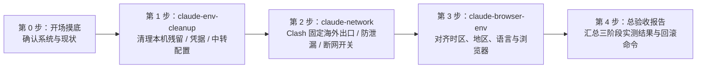

# Claude ENV Setup（Claude 环境设置指南）

<p align="center">
  
</p>

[English](README.en.md) | **简体中文**

一套面向 **Windows 和 macOS** 的 AI Agent Skill 合集，帮助你（无论是**刚被封号准备重置环境**，还是**首次配置稳定可用的 Claude 环境**）按固定顺序、可回滚、可验收地完成 Claude 本机清理、固定海外网络出口与防泄漏、系统时区/语言及浏览器环境对齐。

> **核心理念**：AI 只做只读审计、方案解释、脚本生成与结果验收；所有写盘与管理员操作全部留给用户本人在真实终端里确认执行；每一步都有完整备份和一键回滚，并附带端到端实测验收。

---

## 这套工具解决什么问题？

很多人用 Claude（Web / Desktop / Claude Code）时反复遇到验证、风控或连接异常，常见根源往往叠在一起：

1. **本机残留串号**：旧账号凭据、钥匙串、`userID/machineID`（及历史备份）、旧中转站 API Key 没清干净。
2. **网络出口混乱或泄漏**：机场节点 IP 频繁漂移或落在港澳大陆、DNS 走国内泄漏、IPv6 绕过代理、代理一断直接漏出本地真实 IP、终端里的 Claude Code 与浏览器走的不是同一个出口。
3. **系统与浏览器环境矛盾**：出口在美国/新加坡，电脑时区却是东八区、浏览器 WebRTC 暴露本地宽带 IP、或者直接用之前被封过号的旧浏览器 Cookie 登录。

**Claude ENV Setup** 把这三个环节拆成 3 个独立子 Skill，并由根目录的 [`SKILL.md`](SKILL.md) 作为总控编排，一步一步带你做到最后的总验收。

---

## 整体流程一览



| 顺序 | 模块 | 负责的事情 | 安全与回滚机制 |
|---|---|---|---|
| **总控** | [`SKILL.md`](SKILL.md)（[EN](SKILL.en.md)） | 编排 1 → 2 → 3 严格顺序、防呆提醒、最终汇总验收报告 | 强制前置核对，不跳步 |
| **第 1 步** | [`claude-env-cleanup/`](claude-env-cleanup/) | 审计并清理 Claude Code / Desktop 登录态、钥匙串、中转站配置、轮换 `userID/machineID`、会话与缓存（支持基础/深度两档） | 不永久删除，按类别移入 `~/ClaudeCleanup/<时间>/`，支持 `--rollback` |
| **第 2 步** | [`claude-network/`](claude-network/) | 把 **Clash Verge Rev 2.x** 配成「国内直连、其余全走固定海外出口、断了也不漏」；支持机房直出（A）与静态住宅 IP 链式代理（B）；DNS/IPv6 加固、断网开关、11 项实测验收 | 先完整备份到 `~/clash-guard-backup/` + 桌面「断网急救.txt」+ 失败自动还原 + 一键 `restore` |
| **第 3 步** | [`claude-browser-env/`](claude-browser-env/) | 审计默认浏览器、各 Profile 语言/WebRTC/Claude 痕迹与指纹浏览器；按第 2 步的出口城市对齐系统时区、国家/地区与语言；给出本地浏览器或指纹浏览器逐项清单 | 原值写入 `~/ClaudeBrowserEnv/<时间>/manifest.json`，支持 `--rollback` |

---

## 环境要求

- **操作系统**：Windows 10/11 或 macOS
- **Python**：3.9+（仅使用标准库，无需 `pip install` 任何第三方依赖）
- **代理客户端**（第 2 步必需）：[Clash Verge Rev](https://github.com/clash-verge-rev/clash-verge-rev) 2.x，且已导入可用订阅

---

## 快速开始

### 1. 获取仓库

```bash
git clone https://github.com/Yetu2000/claude-env-setup.git
```

### 2. 安装为 AI Agent Skill

将整个仓库（或根目录 `SKILL.md` 及三个子目录 `claude-env-cleanup/`、`claude-network/`、`claude-browser-env/`）放入你使用的 AI Agent 的 skills 目录中（例如 Codex、Antigravity、Cursor、OpenCode 等）。

> **重要提示**：
> - 如果你打算使用 **Claude Code** 来运行这套 skill，请**不要**直接把仓库只放在 `~/.claude/skills/` 下然后跑第 1 步的 `--mode deep`（深度清理会把 `~/.claude/skills/` 一起挪走备份）。
> - 且正在运行中的 Claude Code **不能清理自己**，第 1 步的写操作必须在普通终端里手动执行。

### 3. 唤醒 AI 按步执行

直接对你的 AI Agent 说：

> 请读取 `claude-env-setup` 的 `SKILL.md`，带我按顺序完成 Claude 环境配置：先清理本机环境，再配置网络和固定海外出口，再对齐时区和浏览器，最后给我一份完整的总验收报告。

你也可以只单独使用其中某一个子 Skill，具体命令行用法见各自目录的 `README.md`：
- [`claude-env-cleanup/README.md`](claude-env-cleanup/README.md)
- [`claude-network/README.md`](claude-network/README.md)
- [`claude-browser-env/README.md`](claude-browser-env/README.md)

---

## 最终验收包含什么？

完成全部 3 步后，AI 会依据脚本实际输出汇总一份**总验收报告**，包含：

1. **本机清理核对**：旧凭据、旧中转站键已清空，环境变量残留提醒，以及回滚批次路径。
2. **网络 11 项实测**：规则模式/TUN/开机自启、国内外分流、固定单一海外出口 IP（非港澳大陆）、DNS 无泄漏、终端直连走 TUN、断网开关生效，以及 3 项故障演练（死节点、关 TUN、退客户端均不回落本地 IP）。
3. **系统与浏览器对齐**：系统时区/地区与出口城市一致、自动时区已关闭、语言列表一致、目标浏览器 WebRTC 防护为 `protected`，并结合 `browserleaks.com/webrtc` 与 `browserscan.net` 实测确认。
4. **急救与回滚速查**：三个模块各自的回滚目录、桌面「断网急救.txt」以及解除断网开关命令。

---

## 当前验证状态与免责声明

- **验证状态**：
  - `claude-env-cleanup` 与 `claude-browser-env` 的核心逻辑和回滚流程均带有离线单元测试。
  - `claude-network` 已在 Windows 11 + Clash Verge Rev 2.5.6 上完成只读体检、节点测速、真实 `mihomo -t` 校验、备份与验收取证测试
- **免责声明**：
  - 本项目仅用于本机环境清理、网络/DNS/IPv6/WebRTC 防泄漏排查与系统环境一致性整理。
  - **不承诺**「零泄漏」或「一定不被封号」，也不能恢复已经被封禁的账号（封禁记录在服务端，恢复只能通过官方申诉）。
  - 请务必遵守 Anthropic 服务条款及支持地区相关规定。

---

## 觉得配置太麻烦太烧心？

如果你只是想稳定、省心地在 Claude Code 或其它客户端里调用 Claude 模型，**不想折腾本地清理、Clash 链式代理、买静态住宅 IP、改时区和指纹浏览器**，也可以直接使用第我们的 API 中转服务：

- **FlashAPI**：[https://flashapi.top](https://flashapi.top) — 开箱即用，省去繁琐的网络与环境配置，适合想直接把精力花在写代码和干活上的朋友。
